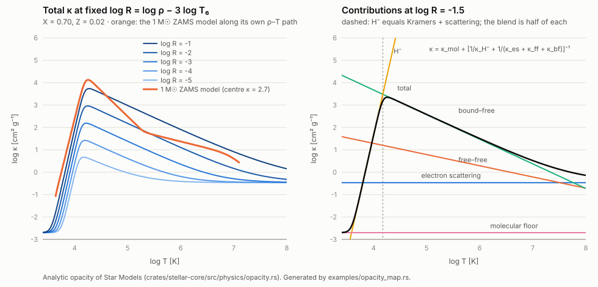

# 7. Microphysics

## Equation of state: fully ionised ideal gas plus radiation

```math
P = P_{\mathrm{gas}} + P_{\mathrm{rad}} = \frac{\rho\, k\, T}{\mu\, m_u} + \frac{a T^4}{3}
```

*Mean molecular weight (full ionisation)*

```math
\frac{1}{\mu} = 2X + \frac{3}{4}\,Y + \frac{1}{2}\,Z
```

```math
\beta = \frac{P_{\mathrm{gas}}}{P}, \qquad \delta = -\left(\frac{\partial \ln\rho}{\partial \ln T}\right)_{\!P} = \frac{4 - 3\beta}{\beta}
```

```math
c_P = \frac{k}{\mu\, m_u}\left[\frac{3}{2} + \frac{12\,(1-\beta)}{\beta} + \frac{(4 - 3\beta)^2}{\beta^2}\right]
```

```math
\nabla_{\mathrm{ad}} = \left(\frac{\partial \ln T}{\partial \ln P}\right)_{\!s} = \frac{2\,(4 - 3\beta)}{32 - 24\beta - 3\beta^2}
```

$`\nabla_{\mathrm{ad}}`$ is 0.4 for a pure gas and 0.25 for pure radiation.

Given $`P`$ and $`T`$, the density follows directly from the first equation. During Newton iterations
$`\beta`$ is limited to at least $`10^{-3}`$, which keeps unphysical trial states finite. Converged
models that reach this floor are rejected.

## Opacity: analytic Rosseland mean (CGS)

*Electron scattering*

```math
\kappa_{\mathrm{es}} = 0.2\,(1 + X)
```

*Kramers free–free*

```math
\kappa_{\mathrm{ff}} = 3.68\times10^{22}\,(1 - Z)(1 + X)\,\rho\,T^{-3.5}
```

*Kramers bound–free*, where $`t`$ is the guillotine factor

```math
\kappa_{\mathrm{bf}} = \frac{4.34\times10^{25}}{t}\,Z\,(1 + X)\,\rho\,T^{-3.5}, \qquad t = 2.82\,\bigl[\rho\,(1 + X)\bigr]^{0.2}
```

*H⁻ ion* (cool envelopes)

```math
\kappa_{\mathrm{H}^-} = 2.5\times10^{-31}\,\frac{Z}{0.02}\,\rho^{1/2}\,T^{9}
```

*Molecular floor*

```math
\kappa_{\mathrm{mol}} = 0.1\,Z
```

*Combined opacity*

```math
\kappa = \kappa_{\mathrm{mol}} + \left[\frac{1}{\kappa_{\mathrm{H}^-}} + \frac{1}{\kappa_{\mathrm{es}} + \kappa_{\mathrm{ff}} + \kappa_{\mathrm{bf}}}\right]^{-1}
```

The harmonic combination makes H⁻ dominate only in cool layers. Without it the steep $`T^9`$ term would
run away at high temperature. For $`Z = 0`$, the H⁻ term uses $`Z = 10^{-4}`$. These coefficients
follow Carroll & Ostlie (2017), converted to CGS.

### Opacity across regimes



The left panel slices the opacity at fixed $`\log R = \log\rho - 3\log T_6`$, as the OPAL and OP
tables do, and overlays the solar ZAMS model along its own $`\rho`$–$`T`$ path. The right panel shows
the separate contributions near that path.

* **The H⁻/Kramers blend is smooth.** Where $`\kappa_{\mathrm{H}^-}`$ equals the Kramers +
  scattering sum ($`\log T \approx 4.18`$ at $`\log R = -1.5`$), the harmonic combination gives half
  of each. That is a dip of at most a factor of 2, with no discontinuity in $`\kappa`$ or its slope.
* **Too high in the core.** At the centre of the 1 M☉ ZAMS model the analytic $`\kappa \approx 2.7`$,
  and at present-day solar central conditions it gives 2.6. Standard solar models with OPAL/OP
  opacities have roughly 1.2–1.5 there. Since $`L \propto 1/\kappa`$ in a radiative core (a homology
  argument), this is the leading suspect for the underluminous analytic Sun (0.42 L☉ instead of about
  0.7 L☉); its share has not been isolated.
* **Too low below the convection zone.** At the present Sun's convection-zone base
  ($`T \approx 2.2 \times 10^6`$ K, $`\rho \approx 0.19`$ g cm⁻³) the analytic opacity is about 9,
  against roughly 20 from OPAL/OP. A lower $`\kappa`$ gives a lower $`\nabla_{\mathrm{rad}}`$, so the
  convective envelope ends too shallow. The missing ionisation zones in the EOS add to this (see
  [Accuracy & limitations](15-limitations.md)).
* **No line opacity or ionisation-edge structure.** Kramers laws are smooth power laws. The real
  opacity has bumps from metal lines and from H and He ionisation (for example the Z bump near
  $`\log T \approx 5.3`$) that these formulas cannot reproduce.

The OPAL/OP figures are approximate values from standard solar models, for orientation. Regenerate the
plot and the reference values with:

```sh
cargo run --release -p stellar-core --example opacity_map -- docs/about/images/opacity.svg
```

## Nuclear energy generation [erg g⁻¹ s⁻¹]

The rate coefficients ($`2.38\times10^{6}`$, $`8.67\times10^{27}`$, $`5.09\times10^{11}`$) are those of
Kippenhahn & Weigert (1990).

```math
T_6 = \frac{T}{10^6\,\mathrm{K}}, \qquad T_8 = \frac{T}{10^8\,\mathrm{K}}
```

*pp chain*

```math
\varepsilon_{pp} = \psi\,\varepsilon_{pp,\mathrm{I}}, \qquad \varepsilon_{pp,\mathrm{I}} = 2.38\times10^{6}\;\rho\, X^2\, f_{1}\, g_{11}\; T_6^{-2/3}\, \exp\!\left(-33.80\, T_6^{-1/3}\right)
```

```math
g_{11} = 1 + 0.0123\, T_6^{1/3} + 0.0109\, T_6^{2/3} + 0.0009\, T_6
```

$`g_{11}`$ is a correction to the p + p reaction rate. $`\varepsilon_{pp,\mathrm{I}}`$ counts the pp I
chain only. Once helium is abundant, ³He also burns with ⁴He (the pp II chain), which makes more
helium per p + p reaction; $`\psi`$ accounts for it (pp III is neglected):

```math
\alpha = \left(\frac{Y}{4X}\right)^{2} \frac{\langle\sigma v\rangle_{34}^{\,2}}{\langle\sigma v\rangle_{11}\,\langle\sigma v\rangle_{33}}, \qquad \phi = 1 + \frac{2}{\sqrt{1 + 2/\alpha} + 1}, \qquad F_{\mathrm{II}} = \frac{2\,(\phi - 1)}{\phi}, \qquad \psi = \phi\,\left(1 - 0.021\,F_{\mathrm{II}}\right)
```

* $`\phi`$ (1 to 2) is the number of helium nuclei made per pp I chain, $`F_{\mathrm{II}}`$ the share
  made through pp II, which deposits 2.1% less energy per helium nucleus.
* The reaction rates $`\langle\sigma v\rangle`$ of p + p, ³He + ³He and ³He + ⁴He are integrated
  numerically from the astrophysical factors $`S(0)`$ of Solar Fusion III (Acharya et al. 2025),
  tabulated once and interpolated smoothly; the screening factors are included.
* This is a hybrid: the pp I rate is still the 1990 fit, which is about 8% below the Solar Fusion III
  p + p rate. The energy-dependence of $`S`$ ($`S'`$, $`S''`$) is not included yet.
* $`\psi`$ is near 1 on the ZAMS ($`\phi = 1.03`$ at the Sun's centre) and grows as helium builds
  up: at 4.57 Gyr $`\phi = 1.10`$ at the centre, where 19% of the helium is made through pp II.
* The hydrogen consumed per unit energy changes with it; see [Evolution in time](12-evolution.md).

*CNO cycle*

```math
\varepsilon_{\mathrm{CNO}} = 8.67\times10^{27}\;\rho\, X\, X_{\mathrm{CNO}}\, f_{7}\, C\; T_6^{-2/3}\, \exp\!\left(-152.28\, T_6^{-1/3}\right)
```

```math
C = 1 + 0.0027\, T_6^{1/3} - 0.00778\, T_6^{2/3} - 0.000149\, T_6, \qquad X_{\mathrm{CNO}} = f_{\mathrm{CNO}}\, Z
```

*Triple-α*

```math
\varepsilon_{3\alpha} = 5.09\times10^{11}\;\rho^2\, Y^3\, f_{4}\, f_{8}\; T_8^{-3}\, \exp\!\left(-\frac{44.027}{T_8}\right)
```

*Weak electron screening* (Salpeter / Clayton)

```math
f_{Z_1 Z_2} = \exp\!\left(0.188\, Z_1 Z_2\, \zeta\, \rho^{1/2}\, T_6^{-3/2}\right), \qquad \zeta^2 = 2X + 1.5\,Y + 4Z
```

The charge products are:

| Reaction | $`Z_1 Z_2`$ |
|---|---|
| p + p | 1 |
| p + ¹⁴N (the slowest CNO step) | 7 |
| α + α | 4 |
| α + ⁸Be | 8 |

The screening exponent is capped at 2, since weak screening is only valid for small values. Every model
reports its largest exponent, with a warning above 0.3 and at the cap (see
[Results](04-results.md#screening-exponent)).

> EOS, opacity and nuclear rates sit behind interfaces (`Eos`, `Opacity`, `Nuclear`), so tabulated
> physics can replace them without touching the solver.

---
← Previous: [Structure equations](06-structure-equations.md) · [Contents](README.md) · Next: [Energy transport & convection](08-energy-transport.md) →
